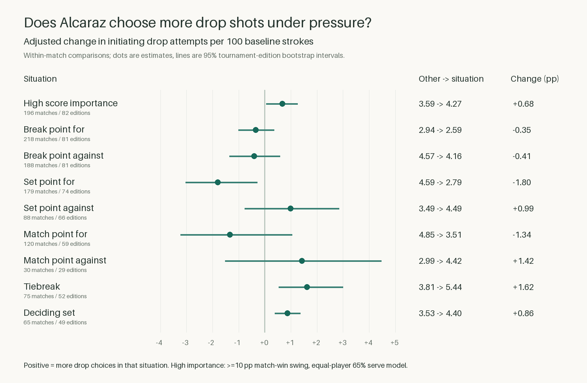
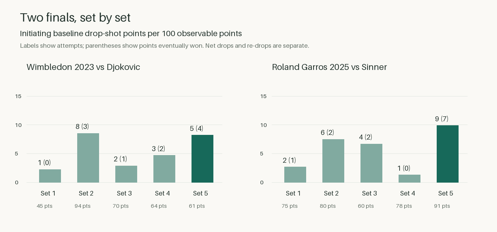

# Alcaraz drop shots under pressure

Tentative support: Alcaraz chooses somewhat more drop shots at high-importance scores in this charted sample.

The primary within-match estimate is **0.68 percentage points** (95% interval **0.06 to 1.26**): 3.59 initiating drops per 100 eligible baseline strokes at lower importance, versus 4.27 at high importance. Relative rate: 1.19.

The result is sensitive to weighting and sample choice: the equal-match and without-the-two-finals checks below retain positive estimates but their intervals include no change. Tiebreaks and deciding sets show increases; the two break-point comparisons are inconclusive. This is not evidence of a uniform response to every kind of pressure.

The raw point-level frequencies are 4.74 versus 5.98 drop-containing points per 100 observable points. Those rates are descriptive and also reflect how many baseline-shot opportunities occur. Eventual point success after a drop is 61.95% versus 67.56%; success is a separate question from usage.



## Familiar pressure situations

Each row compares that situation with its complement, using its own within-match overlap sample. Positive changes mean more drop choices. These secondary comparisons overlap and are exploratory; their intervals are not adjusted for multiple comparisons.

| Situation | Other / 100 strokes | Situation / 100 | Change, pp (95% interval) | Drops / strokes, situation | Matches |
|---|---:|---:|---:|---:|---:|
| High score importance | 3.59 | 4.27 | 0.68 [0.06, 1.26] | 225 / 5354 | 196 |
| Break point for | 2.94 | 2.59 | -0.35 [-1.01, 0.36] | 67 / 2621 | 218 |
| Break point against | 4.57 | 4.16 | -0.41 [-1.36, 0.58] | 79 / 1942 | 188 |
| Set point for | 4.59 | 2.79 | -1.80 [-3.03, -0.29] | 23 / 825 | 179 |
| Set point against | 3.49 | 4.49 | 0.99 [-0.77, 2.85] | 18 / 412 | 88 |
| Match point for | 4.85 | 3.51 | -1.34 [-3.23, 1.05] | 12 / 341 | 120 |
| Match point against | 2.99 | 4.42 | 1.42 [-1.52, 4.46] | 5 / 117 | 30 |
| Tiebreak | 3.81 | 5.44 | 1.62 [0.54, 2.99] | 77 / 1436 | 75 |
| Deciding set | 3.53 | 4.40 | 0.86 [0.39, 1.36] | 230 / 5246 | 65 |

## The two examples



| Final | Set | Initiating drops | Points won after drop | Drops / 100 observable points | All u/y drop attempts |
|---|---:|---:|---:|---:|---:|
| Wimbledon 2023 | 1 | 1 | 0 | 2.22 | 1 |
| Wimbledon 2023 | 2 | 8 | 3 | 8.51 | 9 |
| Wimbledon 2023 | 3 | 2 | 1 | 2.86 | 2 |
| Wimbledon 2023 | 4 | 3 | 2 | 4.69 | 3 |
| Wimbledon 2023 | 5 | 5 | 4 | 8.20 | 5 |
| Roland Garros 2025 | 1 | 2 | 1 | 2.67 | 2 |
| Roland Garros 2025 | 2 | 6 | 2 | 7.50 | 6 |
| Roland Garros 2025 | 3 | 4 | 2 | 6.67 | 4 |
| Roland Garros 2025 | 4 | 1 | 0 | 1.28 | 1 |
| Roland Garros 2025 | 5 | 9 | 7 | 9.89 | 9 |

The Wimbledon fifth set contains **5 coded groundstroke drop attempts, with 4 points won**, rather than the screenshot’s 5/6. The chart therefore does not reproduce that exact claim. Drop volleys use different codes; the detailed source rows are retained for manual/video checking. Earlier sets also contain drop attempts.

The Roland Garros example is confirmed: source point **377**, Alcaraz leading **3–0** in the deciding tiebreak, includes his forehand drop (`u`) and ends with him winning the point. Its modeled match-win swing is **15.54 percentage points**. Being in a deciding tiebreak and having a high-leverage score are different definitions of pressure.

## Sensitivity checks

| Primary score-importance comparison | Change, pp | 95% interval | Matches |
|---|---:|---:|---:|
| primary | 0.68 | [0.06, 1.26] | 196 |
| equal_match | 0.41 | [-0.39, 1.32] | 196 |
| without_two_finals | 0.59 | [-0.03, 1.18] | 194 |
| completed_matches | 0.68 | [0.06, 1.26] | 195 |
| without_exhibitions | 0.73 | [0.13, 1.34] | 194 |

## Data and exclusions

- Snapshot: 222 listed Alcaraz matches, 221 with points; **36,949 source points**, April 2, 2019–April 12, 2026. This is the downloaded snapshot, not all charts currently on the website.
- 220 matches / 36,685 points pass scoring validation. 36,565 points also have fully observable shot sequences.
- The primary contrast uses 196 matches and 82 tournament editions. 9,252 of 46,203 eligible strokes lack high/low overlap within their match, serving status, and stroke-order stratum.
- Existing match-history links: {'unmatched': 21, 'exact': 201}. An unresolved canonical link does not exclude charted points.
- Pressure-excluded matches: `20220703-M-Wimbledon-R16-Jannik_Sinner-Carlos_Alcaraz`.
- One metadata-only Madrid 2023 record has no corresponding points. Missing or malformed shots are unobservable, not zero-drop points.
- Finished prefixes of retirements are retained; a completed-match sensitivity is shown above. Exhibition charts are retained in the all-charted primary sample and excluded in a sensitivity.

Full reasons and source row numbers: [audit](audit.csv), [coverage](coverage.csv), [match links](match_crosswalk.csv). Counts and secondary splits: [descriptive data](descriptive.csv). Full comparison denominators: [comparisons](comparisons.csv).

## Method and limits

A primary attempt is an initiating baseline forehand/backhand drop (`u`/`y`), including errors. Eligible strokes are nonreturn baseline drives, slices, lobs, and drops; net position follows the source’s shot-type defaults and `-`/`=` modifiers. The risk set stops at the first drop or drop volley by either player. Return drops, re-drops, net drops, and drop volleys are reported separately; those descriptive categories can overlap. No tracking data establish whether a drop was physically feasible on each eligible stroke.

Pressure uses only the score before the point: P(match win after winning the next point) minus P(match win after losing it). Both players have a fixed 65% serve-point win probability. High importance means a swing of at least 10 percentage points. This is an equal-strength score benchmark, not an Alcaraz win forecast or a measurement of his emotional state. Future sets begin at 50/50 in this symmetric model; deuce and extended-tiebreak tails are analytic.

For each match × serving/returning status × own eligible-stroke ordinal (1, 2, 3+), calculate low/high attempt rates and weight both by n_low × n_high / (n_low + n_high). Strata without both groups are excluded from that comparison. Retain zero-drop strata. Bootstrap whole tournament editions 2,000 times with seed 20261125; report percentile 95% intervals. The equal-match sensitivity normalizes weights within each contributing match. Final rally length and future outcomes are never explanatory variables.

Chart selection is not random. Within-match comparisons account for stable match differences, but fatigue, ball difficulty, and opponent positioning remain possible explanations. Unknown shot types exclude the entire point from shot denominators. Scoring inconsistencies exclude the entire match from pressure comparisons while preserving its observable shot records. This is an observational, personal analysis; a wide interval means the data are inconclusive.

## Reproduce and sources

```bash
uv run --frozen tennislab analyze-drop-shots --fetch
uv run --frozen tennislab analyze-drop-shots
```

Detailed records are in `data/processed/alcaraz_drop_shots/points.csv` (gitignored). The source lock, code hashes, assumptions and output hashes are recorded in [metadata](metadata.json). The existing Slam-upset results and source locks are unchanged.

- [Tennis Abstract Match Charting Project snapshot](https://github.com/JeffSackmann/tennis_MatchChartingProject/tree/1813a1309b7ed7ebf1c7e884b32bf675d00e4edf), Jeff Sackmann and volunteer chart contributors; CC BY-NC-SA 4.0. The pinned workbook’s Instructions sheet defines the notation.
- [Drop-shot definition and distinction from point success](https://www.tennisabstract.com/blog/2024/03/21/effects-and-after-effects-of-the-carlos-alcaraz-drop-shot/).
- [Grand Slam deciding-tiebreak rule change](https://ausopen.com/articles/news/grand-slams-jointly-adopt-10-point-final-set-tiebreak).
- [Wimbledon 2023 chart](https://www.tennisabstract.com/charting/20230716-M-Wimbledon-F-Novak_Djokovic-Carlos_Alcaraz.html) and [Roland Garros 2025 chart](https://www.tennisabstract.com/charting/20250608-M-Roland_Garros-F-Jannik_Sinner-Carlos_Alcaraz.html), both charted by Edo.
